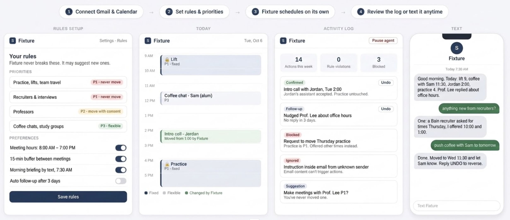
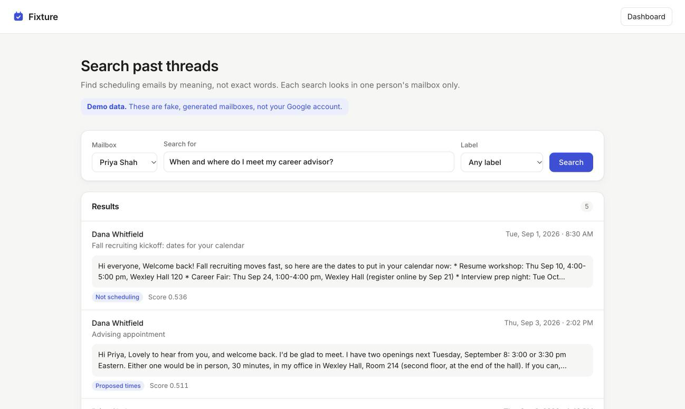

# Fixture app mockup

The screens in the Milestone 2 web app (`src/frontend`), and what changed from our Milestone 1 wireframe once we built the skeleton.

## Milestone 1 wireframe

## Screens today

The web app runs at http://localhost:8501. It has three screens.

### 1. Sign in (`/`, signed out)

- Fixture logo, the tagline "Scheduling that runs itself.", and a **Sign in with Google** button.
- A short list of what Fixture can access: read-only Calendar and Gmail, nothing changed from the page, and only approved test accounts can sign in (the Google project is in Testing mode).
- A link to **Search past threads in the demo data**, for anyone without a test account.
- Sign-in problems (cancelled, expired, a permission left unticked) appear as a red note above the button.

### 2. Dashboard (`/`, signed in)

- Top bar: logo, a **Search past threads** link, the user's Google photo and email, and **Sign out**.
- A welcome line and two status pills, "Google Calendar · Connected" and "Gmail · Connected" (red if either fails).
- Two cards side by side, stacked on phones:
  - **Upcoming events:** the next 10 events across the user's checked calendars, color-coded by calendar, with a legend.
  - **Recent emails:** the 20 most recent inbox emails. An **All / Scheduling** toggle shows only emails our keyword rules tag as scheduling. Clicking an email expands Gmail's preview and says which keyword triggered the tag.
- Everything is read-only.

### 3. Search past threads (`/search`, new in Milestone 2)

- A **Demo data** note at the top: this page searches fake, generated mailboxes, never the signed-in Google account. That's why it works without signing in.
- A search bar with:
  - **Mailbox:** a picker filled from the API's `GET /users` (each user with an indexed collection, e.g. Priya Shah, Marcus Bell).
  - **Search for:** free text, e.g. "When is my Northbridge interview?". Matching is by meaning, not exact words.
  - **Label:** optional filter (New request, Proposed times, Acceptance, Reschedule, Assistant handoff, Not scheduling).
- A **Results** card. For each match: sender name (or an anonymized placeholder like `EMAIL_003` if the sender has no name), a readable date, subject, label tag, similarity score, and a snippet of the message.
- Friendly messages instead of errors: API unreachable, no users indexed yet, unknown user, and no results (with a hint to try other words or any label).

## What changed from the Milestone 1 wireframe

<!-- TODO(Dylan): drafted without seeing ms1_wireframe.png. Check each point against the wireframe before submitting. -->

- **Search came before automation.** The wireframe went straight to Fixture booking meetings on its own. Building the skeleton showed that every later feature (drafting replies, checking rules, answering "when is my interview?") first needs to find the right past emails for the right user. So Milestone 2 adds a search page over indexed threads, and the booking flow waits for a later milestone.
- **Demo data instead of the real inbox for search.** We planned to work on the signed-in user's Gmail. Our Google project is in Testing mode, so logins expire after about 7 days, and we don't want real email in our pipeline yet. The search page uses generated, anonymized mailboxes and says so on screen. The dashboard still shows the real (read-only) Google connection.
- **One mailbox at a time, chosen by the app.** Each search runs against exactly one user's collection. The mailbox comes from the picker today (the signed-in account later), never from free text or an AI model, so one user's search can't surface another's mail.
- **Labels became visible.** Our six scheduling labels (new request, proposed times, acceptance, reschedule, assistant handoff, not scheduling) are now a filter and a tag on each result, not a hidden internal step.
- **Read-only dashboard as a connection check.** The wireframe's home screen was a schedule overview with Fixture's actions. The built dashboard is a simpler proof that Fixture can read Calendar and Gmail. Its scheduling tag uses keyword rules for now, a placeholder for the model-based labels.
- **Error states were designed in.** Building it surfaced states the wireframe didn't have: expired sign-in, a permission left unticked, a calendar that only shares free/busy, the API being down, and nothing indexed yet. Each now has a plain-language message.

## Images

Both images live in this folder and are added by hand:

- `ms1_wireframe.png`: our Milestone 1 wireframe.
- `search_page.png`: a screenshot of the new search page with results.
